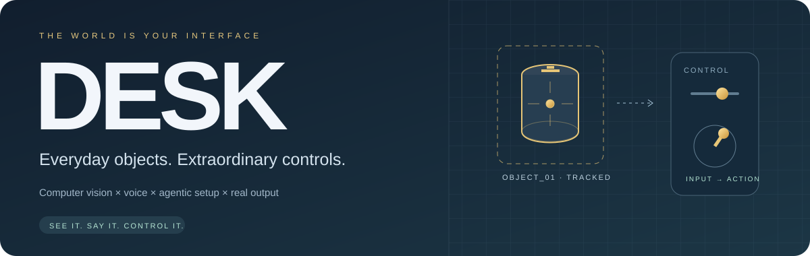
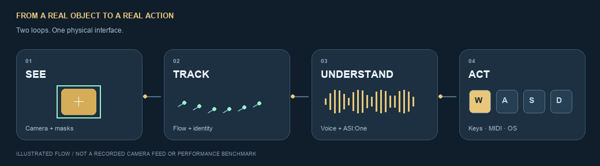
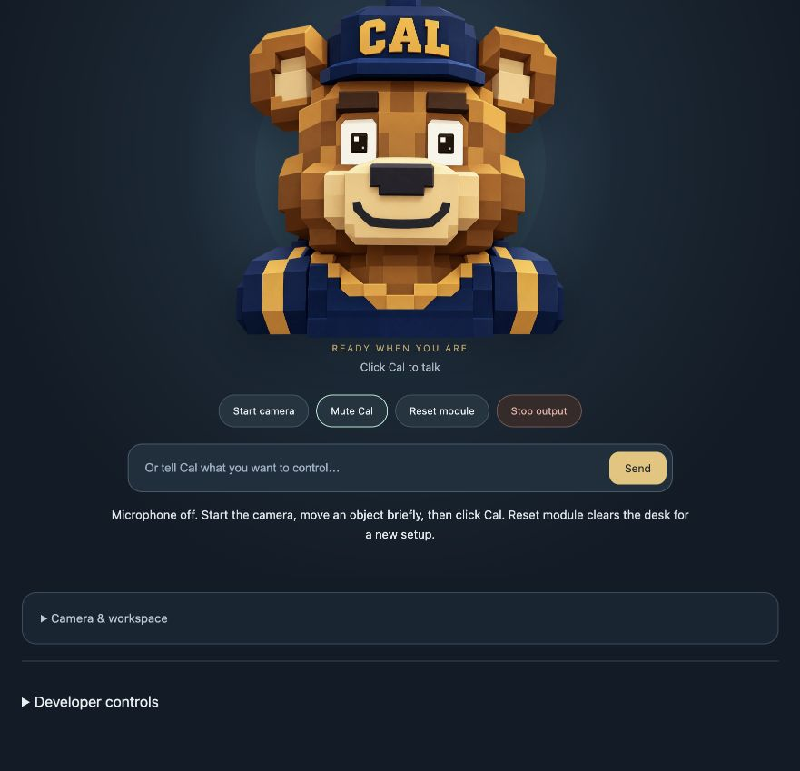
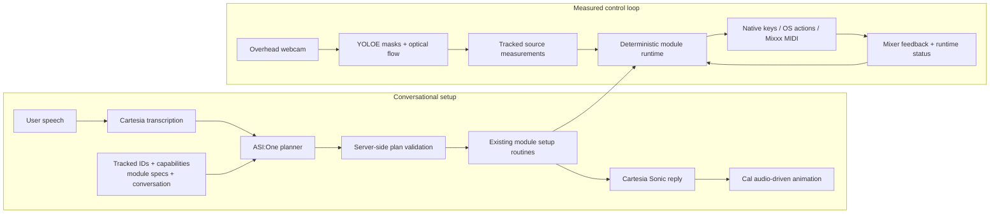
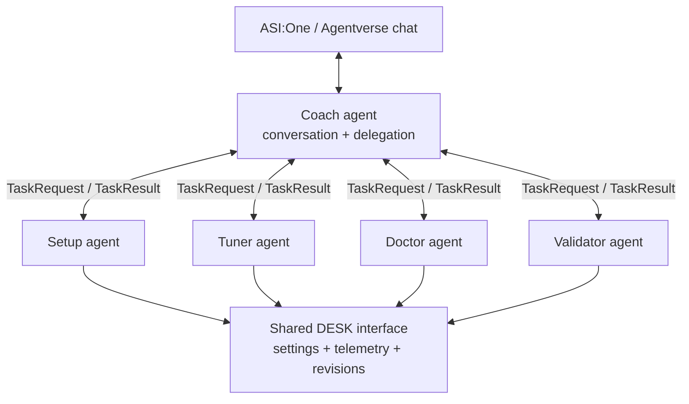

<div align="center">



### Turn the things on your desk into the way you control your computer.

A can becomes a flight stick. A bottle becomes a brightness slider.<br />A few ordinary objects become a DJ mixer. **Tell Cal what you want to do.**


[Meet Cal](#meet-cal) · [Try it](#quick-start) · [Architecture](#how-the-system-fits-together) · [Computer vision](#inside-the-computer-vision-pipeline) · [Five agents](#the-five-fetchai-agents) · [Engineering map](#explore-the-code)

</div>

---

## The idea

Computers have an enormous action vocabulary. Physical interfaces usually give you a fixed set of buttons.

**DESK makes the physical interface programmable.** An overhead camera observes everyday objects; a voice agent resolves what you want to control; existing, deterministic modules turn measured motion or covering into real input. Setup becomes a conversation instead of a screen full of selectors.

You choose the meaning. The same object can be a flight controller now, a slider later, and an app-launch button after a reset.

<div align="center">

<sub>Animated architecture illustration. This is not a recorded tracking demo or a latency benchmark.</sub>
</div>

## Meet Cal

Cal is the face of DESK: a bear you can click to speak to, with pointer-following eyes, blinking, listening/thinking states, and a mouth animated from the actual reply audio.

The character is a presentation layer over the same voice and control system. It does not replace the vision model, reimplement the modules, or invent another execution backend.

<div align="center">

</div>

**Start camera → show an object → click Cal → describe its job.**

| Say this | Physical input | What DESK does |
| :--- | :--- | :--- |
| “Use this can for the flight simulator.” | Displacement of the tracked can top | Arms the existing Flight profile for held W/A/S/D |
| “Use this bottle to play Subway.” | Deliberate sliding flicks | Selects the Subway flick module for arrow-key swipes |
| “Make this object a brightness slider.” | Straight-line translation | Changes built-in display brightness through its registered adapter |
| “Move this object up and down to scroll.” | Relative slider movement | Scrolls the target application |
| “Cover this cup to press Space.” | Cover → uncover cycle | Sends one key press per confirmed cycle |
| “Cover this object to open Calculator.” | Cover → uncover cycle | Opens the exact installed app selected from the action catalog |
| “Use this slider for Deck A volume.” | Calibrated object travel | Maps a real Mixxx fader, with feedback and pickup |

Detection alone **does not assign a control**. Ambiguous objects prompt clarification. Completed setup ends listening; clarification and unfinished DJ calibration can continue through follow-up turns. Text input is available alongside speech.

**Reset module** stops output and clears observations, mappings, game anchors, button registrations, and conversation context. Connected cameras can resume observing the same objects for a new setup.

## Quick start

### 1. Install the local app

Python **3.10+** is supported by the core package; Python **3.12** is a convenient starting point. Native keyboard and desktop action adapters currently target **macOS**. Use a fixed overhead webcam and a browser with camera/microphone access.

```bash
git clone https://github.com/Shrithan/DESK.git
cd DESK

python3.12 -m venv .venv
source .venv/bin/activate
python -m pip install -e '.[ai,dj,joystick,test]'

# Prepare the saved desk-object segmentation profile once.
python -m vision.prepare_model --size x
```

For cover buttons, install the gesture dependencies and download the hand model:

```bash
python -m pip install -e '.[gestures]'
python -m vision.cover --download
```

Model preparation downloads public upstream weights and a text encoder into ignored `outputs/models/`. Inference then runs locally. For a lighter model, prepare `--size s` and launch with `--model-size s`.

### 2. Configure speech and planning

Create `.env` from [`.env.example`](.env.example) if it does not already exist:

```bash
[ -f .env ] || cp .env.example .env
```

Fill in your own credentials locally:

```dotenv
CARTESIA_API_KEY=your_cartesia_key
ASI1_API_KEY=your_asi_one_key

# Optional overrides; these match the current app defaults.
CARTESIA_MODEL_ID=sonic-3.6
ASI1_MODEL=asi1
```

Keys remain server-side. `.env` is ignored by Git. Provider configuration reloads per request.

### 3. Launch

```bash
python -m vision.live --port 8765 --device auto --model-size x --temporal flow
```

Open **[localhost:8765](http://localhost:8765)**. Start the camera, let exposure settle, and briefly move each intended object so it can be acquired. Click Cal and describe your mapping.

For native keys, enable macOS Accessibility for the app running the server, then focus the simulator or target window. For DJ control, complete [Mixxx's MIDI setup](docs/mixxx-dj.md); the virtual port alone is not proof that the mixer is connected.

<details>
<summary><strong>CPU, motion-only, optional temporal tracking, and camera calibration</strong></summary>

```bash
# Force CPU inference.
python -m vision.live --device cpu --model-size s

# Explicit motion-only tracking, without YOLOE weights.
# This exercises tracking; it does not provide YOLOE's semantic object discovery.
python -m vision.live --detector motion

# Optional EdgeTAM correction path, after its separate setup.
python -m vision.live --temporal edgetam

# Calibrated overhead table coordinates.
python -m vision.live \
  --calibration calibration/data/your-rig.json \
  --top-camera cam_1
```

See [temporal tracking](docs/temporal-tracking.md), [camera setup](camera/README.md), [calibration](calibration/README.md), and [metric mapping](docs/calibrated-mapping.md).

</details>

## How the system fits together

DESK separates a **setup loop** from a **control loop**. The language model chooses a validated mapping during setup. It does not generate a fresh command for every camera frame.



### Two decisions before a control is created

1. **Resolve the module.** Is the request about Flight, Subway, the DJ deck, or general buttons/sliders?
2. **Resolve the module's inputs.** Which visible object supplies which controller, target, direction, or calibration step?

The planner receives current object IDs, labels, recently moved context, registered capabilities, existing mappings, and up to eight setup turns. It can return `ready`, `clarify`, `unsupported`, or `stop`.

A ready Flight mapping looks like this:

```json
{
  "object_id": "a-current-tracked-object-id",
  "module": "flight-stick",
  "setup_action": "map",
  "controller": "joystick",
  "output": "keyboard",
  "bindings": {"up": "a", "down": "d", "left": "w", "right": "s"},
  "mode": "game",
  "deadzone": 0.35
}
```

Those bindings intentionally reflect the existing camera mounting and Flight profile; they are not generic screen-space WASD. Validation rejects unavailable sources, incompatible controllers, invalid actions, and altered game-profile bindings.

The browser's [module adapter](vision/web/module-agent.js) then calls the existing `mapGameModule`, `activateControlEntry`, `activateDJPlan`, or `djGuideNext` path. **Voice automates selection and setup; the module still owns execution.**

## Inside the computer vision pipeline

### 01 · Discover instances, not just motion

[YOLOE-26 segmentation](vision/objects.py) uses a saved prompt profile covering desk objects: cans, bottles, cups, boxes, phones, books, pens, balls, mice, keyboards, scissors, remotes, and several overhead circular-object descriptions.

The segmenter turns predicted polygons into masks, computes image-derived features, and filters unusable masks. The default launch selects the extra-large profile; smaller prepared profiles are available. Apple MPS is selected automatically when available, with CPU as the automatic alternative.

[Live sessions](vision/live.py) run discovery asynchronously so expensive recognition does not have to block each optical-flow update. New candidates require consistent observations before acquisition. Motion-only operation is an explicit mode.

### 02 · Track between segmentation corrections

The [2D tracker](tracking2d/tracker.py) combines:

- **Shi–Tomasi feature selection** within a target mask.
- **Pyramidal Lucas–Kanade optical flow** for inter-frame feature motion.
- **Forward/backward checks** to reject inconsistent correspondences.
- **RANSAC affine estimation** to propagate a target robustly from surviving points.
- Feature replenishment as usable corners disappear.

Periodic semantic corrections help maintain object masks. Optional [EdgeTAM](vision/temporal.py) supplies background mask corrections while optical flow remains the per-frame tracker.

### 03 · Recover identity conservatively

SIFT reference descriptors, geometric checks, and repeated consistent matches support recovery after loss. The live object layer also considers appearance, displacement, and ambiguous lookalikes. A matching class label by itself is not enough to prove identity.

Lost tracking is meaningful state. Predicted display positions do not count as fresh measurements for native keyboard delivery.

### 04 · Convert measurements into reusable sources

The UI can express overhead image coordinates in normalized Cartesian form:

```text
x = u / image_width
y = 1 - v / image_height
```

Controller adapters preserve their own axis conventions and inversions. The reusable source vocabulary is **joystick**, **horizontal slider**, **vertical slider**, and **cover button**.

| Source | Measurement and interpretation |
| :--- | :--- |
| Flight joystick | Fixed first-detection reference; can-top displacement from skeleton coordinates or a centroid/center fallback; existing deadzone and held-key profile |
| Subway flick | Short motion history, travel threshold, direction arbitration, settling, and reversal detection; one pulse per deliberate flick |
| Slider | Normalized position or relative movement, with target-specific direction, smoothing, and output limits |
| Cover button | Hand/object overlap **and** appearance change in a smaller saved region; uncovering resets the cycle |

### 05 · Preserve the difference between 2D and 3D

The ordinary overhead workspace is **image-relative 2D**, not measured 3D. Table-plane calibration enables metric table coordinates. Calibrated multi-view reconstruction additionally needs camera intrinsics, poses, shared feature correspondences, and reprojection/depth checks.

Independent box centers are not triangulated into pretend XYZ. Browser receipt/sample times also do not establish synchronized camera exposure. See [geometry and timing limits](docs/live-dual.md).

## Cartesia: listening, speaking, and making Cal feel alive

The current app uses three connected pieces:

| Piece | Implementation | Role |
| :--- | :--- | :--- |
| User-started capture | [`commands.js`](vision/web/commands.js), [`mic-worklet.js`](vision/web/mic-worklet.js) | Collects microphone samples, detects an utterance pause, and builds a 16 kHz mono PCM WAV |
| Speech recognition | [`speech_input.py`](vision/speech_input.py) | Sends a bounded in-memory clip to Cartesia's STT endpoint with `ink-whisper` |
| Spoken responses | [`reply_speech.py`](vision/reply_speech.py), [`voice.py`](vision/voice.py) | Uses Cartesia speech synthesis; the configured default is `sonic-3.6` |
| Character playback | [`bear/interface.js`](vision/web/bear/interface.js), [`bear/face.js`](vision/web/bear/face.js) | Drives the jaw from the decoded audio waveform, plus gaze, blinks, and visual state |

Cal's mouth follows the actual reply buffer rather than an unrelated looping “talking” animation. It shares the existing audio destination, so the character does not introduce a second speech request or double playback. Reduced-motion styling is supported.

This checkout uses clip-based recognition. The separate [bear voice studio branch](https://github.com/Shrithan/DESK/tree/bear-voice-studio) contains an alternative streaming-STT/tool-agent interface; its backend was not substituted into the current module system.

## The five Fetch.ai agents

Alongside the camera-and-voice app, we built **DESK Coach**, a five-agent setup, tuning, diagnosis, and validation companion using Fetch.ai's `uagents` framework and ASI:One-facing chat.

> **Where this code lives:** the five-agent implementation is on [`fetch-five-agent-integration`](https://github.com/Shrithan/DESK/tree/fetch-five-agent-integration), with a related [`fetch-five-agents-spatial`](https://github.com/Shrithan/DESK/tree/fetch-five-agents-spatial) branch. The current `main` app calls ASI:One directly for module mapping. The companion branch documents a shared simulated player; connecting its tilt telemetry to live camera angles requires an adapter. The five agents are not all running inside `vision.live`.

| Agent | Responsibility | Concrete behavior |
| :--- | :--- | :--- |
| **1 · Coach** | Conversational coordinator | Holds per-user context, routes tasks to specialists, and presents plans, results, follow-ups, and undo actions |
| **2 · Setup** | Profiles and input configuration | Reads current settings, resolves game profiles or custom key styles, proposes configuration, and applies the selected setup |
| **3 · Tuner** | Telemetry-based sensitivity | Reads a 60-second telemetry window, derives tuning changes, stores a baseline, and compares later play with the earlier measurements |
| **4 · Doctor** | Diagnosis and recovery guidance | Inspects status and recent telemetry for tracking, calibration, frame-rate, and flicker problems; returns concrete repair actions |
| **5 · Validator** | Post-change verification | Watches a fresh 20-second window, assesses the change against the baseline, and conditionally rolls back only the matching configuration revision |



The specialists run together in a **Bureau** on a local endpoint; the Coach runs separately with an Agentverse mailbox. A local-first resolver routes inter-agent messages to the local specialist service. Stable seeded identities keep addresses consistent between launches.

[`TaskRequest` and `TaskResult`](https://github.com/Shrithan/DESK/blob/fetch-five-agent-integration/agents/messages.py) carry correlation IDs, user identity, task kinds, success state, narrated steps, and optional UI cards/validation data. Revision-aware rollback prevents the Validator from undoing a newer user change.

This gives DESK two complementary forms of reasoning: **what should this physical object control?** in the main mapping loop, and **how should the controller be configured, tuned, and repaired?** in the companion agent workflow.

<details>
<summary><strong>Run the five-agent companion separately</strong></summary>

Use a separate checkout and environment for the integration branch. Its package defines the `fetch` and `keys` extras; the main branch does not.

```bash
git clone --branch fetch-five-agent-integration \
  https://github.com/Shrithan/DESK.git desk-agents
cd desk-agents
python3.12 -m venv .venv
source .venv/bin/activate
python -m pip install -e '.[fetch,keys]'
```

In two terminals using that environment:

```bash
# Terminal 1 — four specialist agents, shared simulated player.
DESK_DEMO_MODE=1 python -m agents.run specialists

# Terminal 2 — standalone Coach.
DESK_DEMO_MODE=1 python -m agents.run coach
```

Follow the printed Agentverse mailbox setup and the branch's [Coach guide](https://github.com/Shrithan/DESK/blob/fetch-five-agent-integration/agents/COACH_README.md). Demo mode does not validate live camera-to-angle integration.

</details>

## The execution layer: real actions, bounded behavior

### Flight and Subway

Flight uses the existing fixed-reference joystick geometry and camera-mount-specific W/A/S/D bindings. Deflection holds keys, neutral releases them, and diagonal deflection can hold both axes. Subway's sliding profile uses flick detection and short arrow-key pulses instead.

Native keyboard output is owned by an arming token, accepts only its configured keys, checks source visibility, and releases held keys after a **350 ms input stall**. Flight can retain the explicit assignment across a heartbeat interruption while still releasing the keys. Dashboard form focus suppresses delivery; focus the external target app to use the controller.

### General controls

An [action registry](vision/desktop_actions.py) declares supported targets, compatible controllers, and availability. Independent general mappings reuse [ActionRuntime / ActionGroup](vision/action_runtime.py) rather than duplicating slider or button implementations for each action.

Brightness and volume are continuous parameters; scrolling is movement-driven; keyboard presses and installed-app launches are discrete actions. App buttons keep their assignment through heartbeat pauses and require a fresh uncovered view before another cover can fire.

### Mixxx: physical objects, actual mixer state

The [DJ runtime](vision/mixxx.py) creates independent slider mappings for Deck A/B volume, crossfader, and low/mid/high EQ. The [Mixxx controller mapping](mapping/) supplies actual parameter feedback.

1. Bind an object to a registered fader.
2. Measure its minimum and maximum travel positions.
3. Enable output with a live MIDI feedback connection.
4. Move through the current mixer value to **pick up** the fader without a jump.

The runtime smooths input, bounds write frequency and slew, and handles each fader independently. Tracking loss holds the mixer value; recovery requires pickup. No audio playback is started automatically.

## Data boundaries and practical limits

| Data / operation | Where it goes |
| :--- | :--- |
| Camera frames, masks, features, tracking | Local CV process; latest frames held in memory |
| Microphone command clips | Sent to Cartesia for transcription |
| Transcript, object metadata, capability catalog, setup context | Sent to ASI:One for mapping plans; camera images are not sent |
| Reply text | Sent to Cartesia for synthesis |
| Provider keys | Server-side configuration; not embedded in the browser |
| Keys, MIDI, display/audio changes | Local registered output adapters |

DESK is a loopback, single-user prototype. Lighting, motion blur, texture, occlusion, camera mounting, and browser background throttling affect tracking and control delivery. Model classes can be wrong. Session mappings are not a persistent physical-object identity database.

Scheduling bounds, watchdog timings, and smoothing constants describe implementation behavior; they are not measured end-to-end latency or accuracy claims. Stop/reset and freshness checks remain part of the execution path.

## Explore the code

| Area | Start here |
| :--- | :--- |
| Live server, frame intake, sessions, routes | [`vision/live.py`](vision/live.py) |
| Detection, masks, object features | [`vision/objects.py`](vision/objects.py) |
| Optical flow and recovery | [`tracking2d/tracker.py`](tracking2d/tracker.py) |
| Declarative planning and validation | [`vision/morph.py`](vision/morph.py) |
| Voice-to-module orchestration | [`vision/web/module-agent.js`](vision/web/module-agent.js) |
| Original game control profiles | [`vision/web/game-controls.js`](vision/web/game-controls.js) |
| Native key delivery and watchdog | [`vision/keyboard.py`](vision/keyboard.py) |
| Desktop actions and independent mappings | [`vision/action_runtime.py`](vision/action_runtime.py), [`vision/desktop_actions.py`](vision/desktop_actions.py) |
| DJ control and Mixxx preset | [`vision/mixxx.py`](vision/mixxx.py), [`mapping/`](mapping/) |
| Cal artwork, animation, presentation adapter | [`vision/web/bear/`](vision/web/bear/) |
| Camera rigs, geometry, printable hardware | [`camera/`](camera/), [`calibration/`](calibration/) |
| Five-agent companion | [`agents/` on the integration branch](https://github.com/Shrithan/DESK/tree/fetch-five-agent-integration/agents) |

<details>
<summary><strong>Technical guides</strong></summary>

- [Voice module setup and reset](docs/morph-mapping.md)
- [Flight controller](docs/flight-module.md) · [Game modules](docs/game-modules.md)
- [General sliders and buttons](docs/general-controls.md) · [Desktop action adapters](docs/desktop-actions.md)
- [Mixxx installation, MIDI feedback, and calibration](docs/mixxx-dj.md)
- [Vision architecture](docs/vision.md) · [Temporal tracking](docs/temporal-tracking.md)
- [Metric table mapping](docs/calibrated-mapping.md) · [Multi-view geometry limits](docs/live-dual.md)
- [Camera inputs](docs/camera-input-options.md) · [Exposure](docs/camera-exposure.md)
- [Standalone can joystick](docs/can_joystick.md)

</details>

## Verification

Tests use synthetic frames, fixtures, fake provider transports, and recording output backends where appropriate. They verify contracts and behavior; they do not substitute for a physical camera, microphone, game, or mixer trial.

```bash
# Python behavior, geometry, HTTP, provider/schema, and output tests.
python -m pytest -q

# Frontend mapping, Flight delivery, DJ calibration, and Cal audio wiring.
node tests/test_module_agent.cjs
node tests/test_flight_key_delivery.cjs
node tests/test_game_modules.cjs
node tests/test_dj_guide.cjs
node tests/test_bear_audio.cjs
node tests/test_no_auto_mapping.cjs
```

Cal's presentation sources are bundled into existing served assets with `python scripts/build_bear_ui.py`. The README artwork can be regenerated with `python scripts/build_readme_assets.py` using Pillow. Neither build changes the control backend.

## Built with

**Ultralytics YOLOE · OpenCV · NumPy · Cartesia · ASI:One · Fetch.ai uAgents · Agentverse · Web Audio · Mixxx MIDI**

The optional Ultralytics components and weights have their own upstream licensing, including AGPL-3.0 terms; review those terms for your use. Cal's artwork and original face animation were reused from this repository's [bear voice studio branch](https://github.com/Shrithan/DESK/tree/bear-voice-studio). Third-party services and dependencies retain their respective terms.

---

<div align="center">

**The next input device might already be sitting on your desk.**

<sub>Built for a hackathon. Designed around a simple idea: give ordinary objects a programmable purpose.</sub>

</div>
