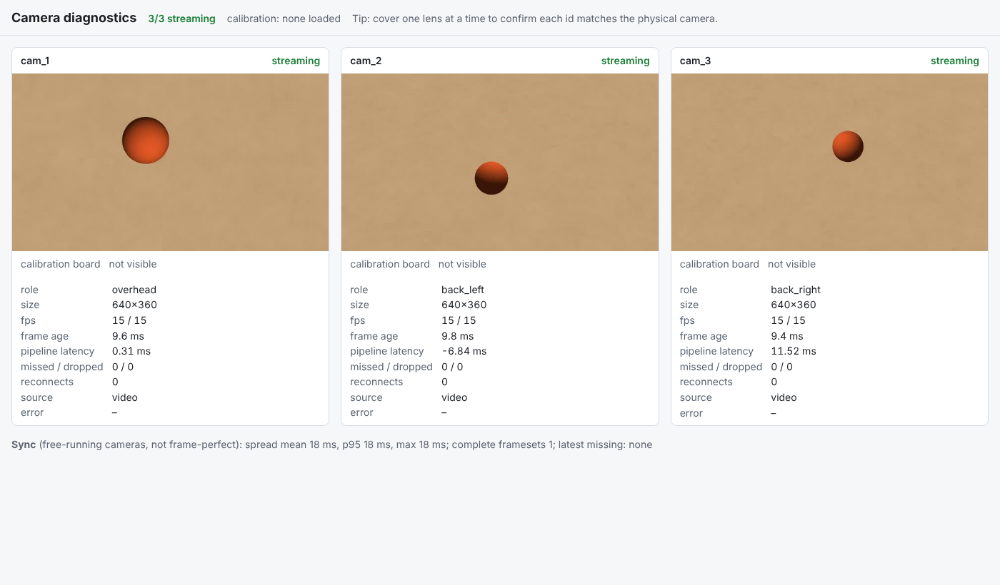

# camera/: ingest for three Logitech C270 webcams (Agent 1)

This folder gets three USB webcams into one process on the MacBook. It provides:
- timestamped frames, delivered newest-first so latency can't build up;
- detection of unplugged cameras, with reconnects that keep each camera's id;
- timestamp pairing across cameras, with sync metrics;
- a diagnostics page with all three feeds.

It runs offline from recorded or synthetic clips for agents without cameras.

Hardware (the frame and printed mounts) is in [`hardware/c270_frame/`](hardware/c270_frame/README.md). Calibration is in [`../calibration/`](../calibration/README.md). The setup guide is [`../docs/camera_setup.md`](../docs/camera_setup.md).

## Setup
**macOS (Apple Silicon)**
```bash
python3 -m venv .venv && source .venv/bin/activate
pip install -r camera/requirements.txt
pip install pyobjc-framework-AVFoundation   # exact, stable camera ids on macOS (recommended)
```
The first run asks for camera permission for your terminal app (System Settings → Privacy & Security → Camera). Allow it, then restart the terminal.

**Linux / Windows:** use the same `pip install -r camera/requirements.txt`.
- On Linux, use `/dev/v4l/by-path/...` ids.
- On Windows, only index-based ids are available.

## Run
```bash
python -m camera devices                        # what is plugged in + the ids to put in the rig config
python -m camera serve                          # real cameras -> http://127.0.0.1:8100/
python -m camera serve --video-dir camera/fixtures/synthetic_rig   # no cameras: recorded synthetic clips
python -m camera serve --fixture synthetic      # no cameras: moving test pattern
python -m camera identify                       # cover one lens at a time to confirm cam_1/2/3
python -m camera record --seconds 10 --out recordings/run1          # save real clips (don't commit them)
python -m pytest -q camera calibration          # all tests (~40 s)
```

### Pinning the camera ids (do this once per machine)
1. Plug each C270 into its **own fixed hub port** and label the cables `cam_1`..`cam_3`.
2. Run `python -m camera devices`. On macOS each C270 shows a `unique_id` that encodes its USB port.
3. Copy each `unique_id` into `camera/config/rig_c270.json` under that camera's `source`. On Linux use `linux_by_path` instead.
4. Run `python -m camera identify` and cover each lens in turn to confirm the mapping.

If a configured id isn't present, that camera reports `disconnected` with a clear error. It never takes another camera's id. A plain `index` still works, but it is flagged `unstable_id` in the inventory because indexes can shift after replugging.

## Using frames (agent 2)
In the same process (recommended for full-rate processing):
```python
from camera.rig import load_rig
from camera.ingest import CameraHub

hub = CameraHub(load_rig()).start()        # or load_rig(overrides={...}) for clips; see camera/__main__.py
sub = hub.subscribe("cam_1")               # newest-frame mailbox: a slow consumer drops frames, never lags
frame = sub.get(timeout=1.0)               # camera.frame.CameraFrame
frame.image                                # BGR uint8, H x W x 3
frame.capture_time_monotonic_ns, frame.receive_time_monotonic_ns, frame.frame_size, frame.calibration_version

fs = hub.frameset()                        # one frame per camera, matched by capture time
fs.frames, fs.spread_ms, fs.missing        # missing = cameras with no frame within tolerance
```
From another process, use the HTTP API on port 8100:

| endpoint | use |
|---|---|
| `GET /api/cameras` | inventory: ids, roles, sizes, device identity, nominal pose, health ([schema](schema/camera_inventory.schema.json)) |
| `GET /api/health` | ok / degraded / unusable summary for agent 4, ≤ 1 Hz ([schema](schema/camera_health.schema.json)) |
| `GET /api/cameras/{id}/snapshot.jpg?max_width=` | newest frame; timestamps in `X-Capture-Time-Monotonic-Ns` and the other `X-*` headers |
| `GET /api/frameset?tolerance_ms=&max_width=` | matched frames as base64 JPEG + metadata (low rate) |
| `GET /api/cameras/{id}/stream.mjpg` | preview for the diagnostics page only |
| `GET /api/cameras/{id}/board_check` | is the whole calibration board visible (for aiming) |
| `GET /api/sync`, `GET /api/calibration` | sync statistics; the current calibration JSON |

Timestamps use the host's `time.monotonic_ns()`, which is the same clock for every camera and every process on the Mac.
- **Recorded and synthetic sources:** `capture_time` is exact.
- **USB webcams:** `capture_time` is the receive time minus `--latency-ms`, which defaults to 0. UVC through OpenCV doesn't report when the image was exposed. See "Sync" below.

## Sync: what is and isn't guaranteed
- **No shared shutter:** the C270s free-run, so nothing aligns their exposures. At 30 fps two cameras can be up to about 16.7 ms apart even with perfect timestamps.
- **Pairing:** `frameset()` uses the newest frame of the slowest camera as the reference and picks the closest frame from each other camera. Cameras outside the tolerance (default 20 ms) are listed in `missing`; they are never silently paired.
- **Metrics:** `/api/sync` reports the spread (mean, p50, p95, max) and the ratio of complete sets.
- **Constant offsets:** `camera.sync.estimate_offset_ms` estimates a constant per-camera latency offset by cross-correlating motion seen by two cameras. On a synthetic signal it recovers a known 25 ms offset to within 3 ms (unit test).

## Measured so far
These numbers are from synthetic or recorded sources only. No C270 hardware has been attached to this build yet.

| metric | target | measured | how |
|---|---|---|---|
| frame age at a slow consumer | bounded | < 100 ms with the consumer 8× slower than the camera | `test_ingest.py` |
| reconnect after unplug | same id, automatic | resumes after backoff with the same id | `test_ingest.py` (simulated unplug) |
| frameset spread, fixture clips | report, don't hide | 18 ms, exactly the simulated +7 / −11 ms offsets | `test_integration_fixture_rig.py`, `/api/sync` |
| 3D error on the synthetic ball (clips → ingest → frameset → triangulation) | — | median < 10 mm, limited by blob centroid and one-frame timing | `test_integration_fixture_rig.py` |
| real USB latency, fps under load, dropped frames | measure | **not yet measured: needs the C270s** | `/api/health` on the real rig |


