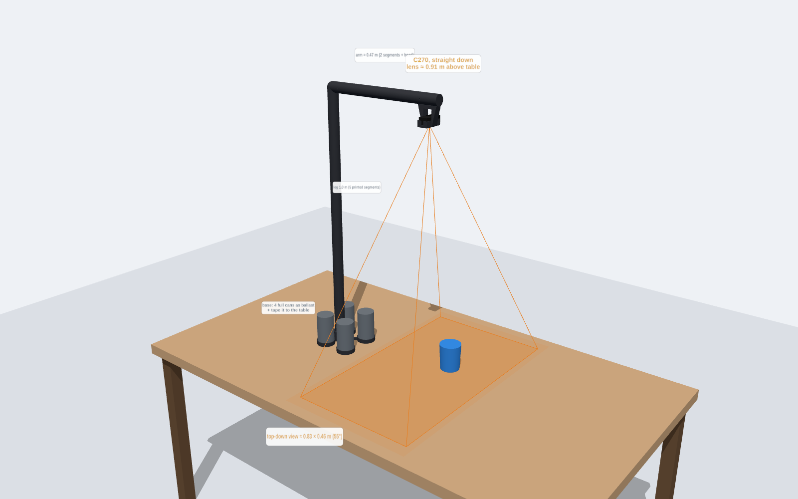
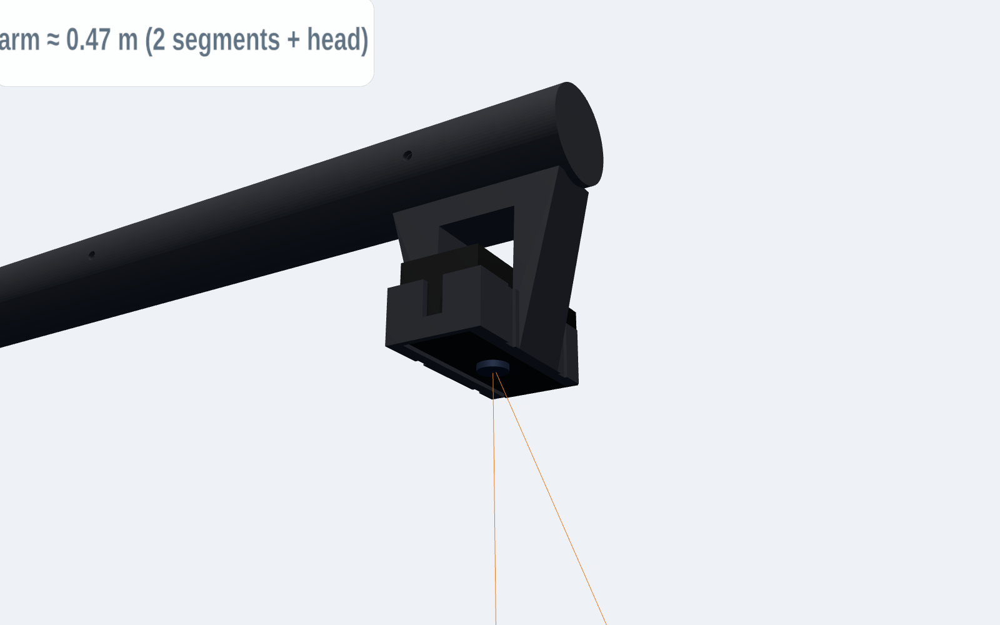
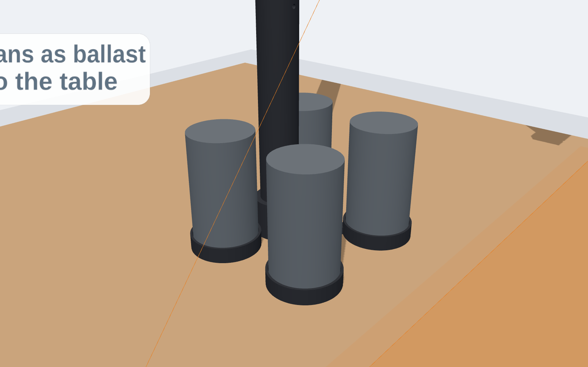

# Printed camera boom: 1 m leg, ~0.5 m arm, one C270 looking straight down

A printable version of the taped tube stand: a weighted base, a 1.0 m leg, an arm of about 0.47 m, and a C270 at the tip pointing **straight down**. It's split into parts that each fit one Cal Hacks print job.



| camera head | base with can ballast |
|---|---|
|  |  |

## What the camera sees
| | value |
|---|---|
| lens height | ≈ 0.91 m above the table |
| lens position | 0.43 m out from the leg |
| top-down view (55° lens) | **≈ 0.83 × 0.46 m** |
| top-down view (60° lens) | ≈ 0.92 × 0.52 m |
| resolution | ≈ 0.65 mm per pixel |

- **Image orientation:** the long image axis runs across the arm, so the leg and base stay out of the picture. A test checks this.
- **Focus:** at 0.9 m everything is well past close-up range for the fixed-focus C270.
- **One camera means monocular:** it measures X/Y on the table plane. Height (Z) needs a second view, such as your existing taped stand or another one of these. Downstream must label single-view depth as estimated (contract rule).

## Parts (print one per job)
Times are from PrusaSlicer 2.7 with generic fast settings (PLA, 0.2 mm layers, 3 walls, 15 % gyroid, 5 mm brim). They are probably pessimistic for a P1S; use Bambu Studio's estimate on the form.

| file | qty | size (mm) | supports | est. time | filament |
|---|---|---|---|---|---|
| `stl/print_segment.stl` | **7** (5 leg + 2 arm) | 40 × 40 × 210 | none | ~1 h 45 m each | ~72 g each |
| `stl/print_base.stl` | 1 | 176 × 192 × 70 | none | ~2 h 25 m | ~105 g |
| `stl/print_elbow.stl` | 1 | 75 × 40 × 75 | organic/tree | ~2 h | ~50 g |
| `stl/print_head.stl` | 1 | 80 × 71 × 107 | organic/tree | ~2 h 40 m | ~73 g |

**Total:** 10 jobs, about 20 h of printer time and 0.75 kg of PLA.
- Every part fits the Adventurer 5M (220 mm) and the P1S.
- Spread the jobs across teammates, since each person can only have one job in the queue.
- Segments print upright with the spigot on top and no supports. Print them first: they're all identical, so any finished one is useful.

**Hardware:**
- 9 × M4 × 50 bolt + nut, one per joint. A 4 mm pin or a zip tie through the holes also works.
- 4 full drink cans (about 1.5 kg of ballast).
- Duct tape or a clamp for the base.
- 2 zip ties for the camera.
- A USB extension, because the C270's 1.5 m cable is about the length of the stand.

## How it goes together
```
base (hub spigot) → leg 1 → leg 2 → leg 3 → leg 4 → leg 5 → elbow → arm 1 → arm 2 → head (C270 facing down)
```
1. **Joints:** each segment's top spigot slides 30 mm into the next segment's bore (0.25 mm clearance per side).
2. **Bolts:** put an M4 bolt through the cross hole at every joint.
3. **Line up the holes:** the holes are what set the rotation. With every bolt through, the arm points straight out from the leg and the camera points straight down.
4. **Camera:** fold the C270's clip back, slide the camera into the sleeve from the open end, and zip-tie it through the two grooves. Run the cable along the arm and leg with zip ties. The tubes are hollow (30 mm), so you could also feed it inside, but the USB-A plug has to fit through.
5. **Base:**
   - Stand **4 full cans** in the rings. The rings sit toward the arm side on purpose.
   - **Tape or clamp the base to the table.**
   - The cable exits through the slot in the hub, on the side away from the arm.

## Stability: tape it down
The arm puts the stand's centre of mass about 13 cm out from the leg. The base's tipping edge is 12 cm out.

| condition | result |
|---|---|
| no ballast | **tips over** |
| 4 full cans | stands, but a sideways push of ~1.3 N at camera height tips it |
| 4 cans + tape or a clamp on the base | what to use |

These figures are calculated, not measured. Any movement of the stand also moves the camera, and that breaks calibration. Re-run `python -m calibration verify` after any bump.

## Software
- **Rig config:** [`camera/config/rig_c270_boom.json`](../../config/rig_c270_boom.json) (one camera, `cam_1`).
- **Run it:**
  ```bash
  python -m camera --rig camera/config/rig_c270_boom.json serve
  python -m calibration intrinsics --camera cam_1 --square-mm <measured>
  python -m calibration extrinsics --rig camera/config/rig_c270_boom.json --square-mm <measured>   # board under the camera
  ```

## Regenerate / test
```bash
pip install manifold3d trimesh numpy pytest
python camera/hardware/c270_boom/generate_boom.py      # STLs + assembled_preview.stl
python -m pytest -q camera/hardware/c270_boom           # single pieces, bed size, no collisions, bolts line up, clear view
```
All dimensions are at the top of `generate_boom.py`: tube 40 mm OD with a 2.4 mm wall, 180 mm segments, 5 leg + 2 arm segments.
- **Taller stand:** add a leg segment (+18 cm).
- **Longer arm:** add an arm segment (+18 cm). The stand then needs more ballast; re-run the stability numbers above.

## Not yet verified
- The C270 body size (73 × 32 × 30 mm, from spec sheets) and the joint fit are untested on a real print.
- **Test first:** print one segment plus the head, then check the joint fit and that the camera sits snugly before printing the rest.
