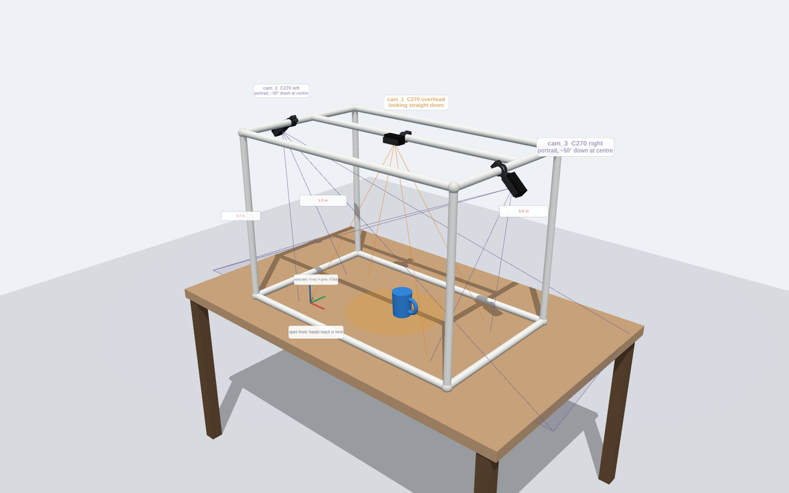
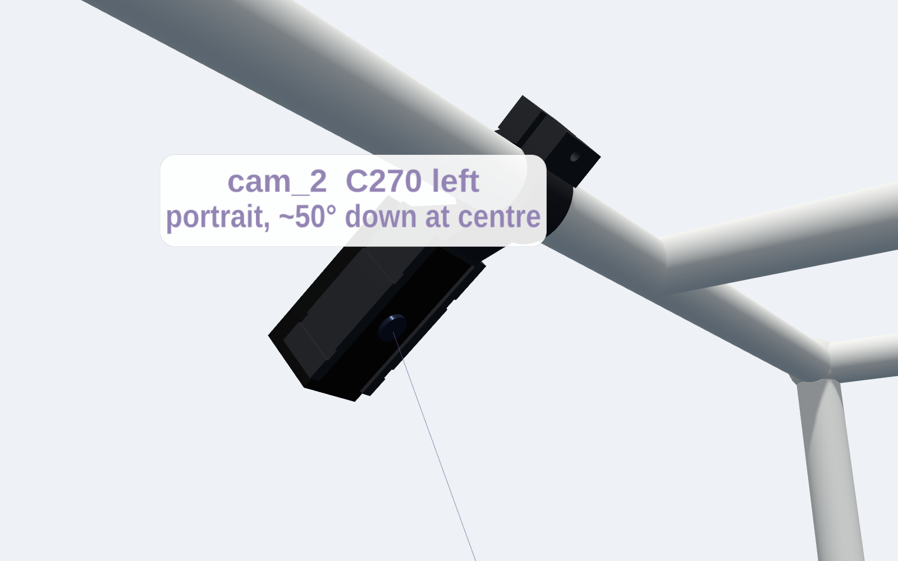
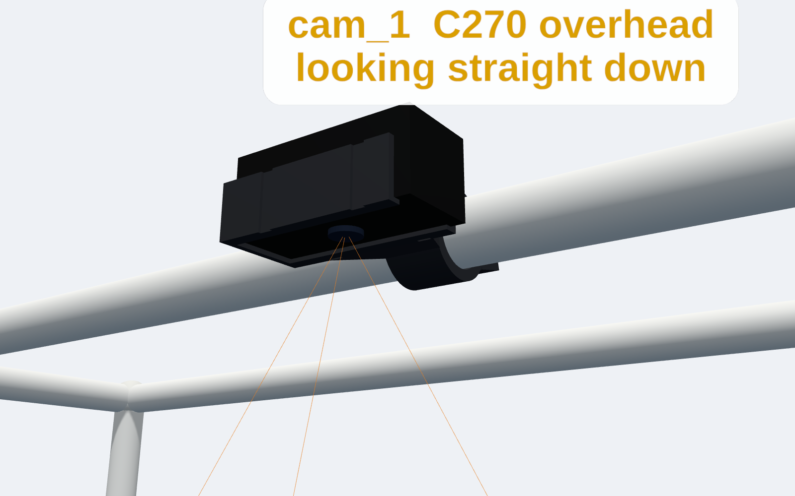

# Tabletop camera frame: 3× Logitech C270

A self-standing box frame, **1.0 m wide × 0.6 m deep × 0.7 m tall**, that sits on the table and carries all three webcams:
- **`cam_1`** looks straight down from a crossbar.
- **`cam_2` and `cam_3`** hang from the middle of the left and right top rails, turned to **portrait**, and look about 50° down toward the table centre.
- **The front is open**, so you can reach in.

Because all three cameras are on one rigid frame, **you calibrate once and can move the whole frame without recalibrating**, as long as no clamp or joint moves.



| side mount (`cam_2`, portrait) | overhead mount (`cam_1`) |
|---|---|
|  |  |

All geometry comes from [`camera/config/rig_c270.json`](../../config/rig_c270.json), and the calibration software reads the same file. If you change the frame size or a camera position there, regenerate the mounts and re-run `tools/coverage.py`.

## Why 0.7 m tall and portrait side cameras
The C270's lens is narrow: about 55–60° diagonal, which is only about 49° × 29° at 16:9 (sources disagree on 55 vs 60). A tracked object has to be inside **all three** views. A taller object makes this harder, because its top is closer to the overhead lens.

Shared area for objects from the table up to 15 cm tall, from `python camera/hardware/c270_frame/tools/coverage.py` (55° / 60° lens):

| design | all 3 cameras see |
|---|---|
| previous: 0.5 m tall, side cameras at the back corners, landscape | **5 × 9 cm** / 9 × 14 cm (unusable) |
| 0.7 m tall, back corners, landscape | 13 × 21 cm / 16 × 27 cm |
| 0.7 m tall, side rails, landscape | 21 × 25 cm / 21 × 25 cm |
| **0.7 m tall, side rails, portrait (this design)** | **43 × 23 cm / 48 × 25 cm** (56 × 25 cm at table level) |
| 0.8 m tall, side rails, portrait | 52 × 29 cm |

The overhead camera's 29° short axis is now the limit, so depth (front-to-back) is what you give up. Turning the side cameras to portrait puts their long image axis along the viewing slope, which doubles the shared width.

**If one camera drops out:** the remaining pair still shares about 43 × 23 cm (overhead + one side) or 64 × 18 cm (both sides).

| camera | lens position (m) | aim | distance to the work area |
|---|---|---|---|
| `cam_1` overhead | (0, 0, 0.69) | straight down, landscape | 0.54–0.69 m |
| `cam_2` left | (−0.55, −0.07, 0.66) | ~50° down at (0, 0, 0), portrait | about 0.8 m |
| `cam_3` right | (0.55, −0.07, 0.66) | ~50° down at (0, 0, 0), portrait | about 0.8 m |

- **Resolution:** about 0.5 mm per pixel on the table for the overhead camera.
- **Focus:** the C270 is fixed-focus, set at the factory for video-call distance. I couldn't find a published minimum focus distance. Everything here is ≥ 0.5 m from a lens, which should be in its sharp range, but **check sharpness on a real camera** before cutting pipe.

## Parts list
| item | qty | notes |
|---|---|---|
| 3/4" schedule 40 PVC pipe (OD 26.7 mm) | about 10.5 m | or any rigid round tube; set `tube_od_mm` and regenerate the mounts |
| 3/4" 3-way corner fittings (side-outlet elbows, "furniture" fittings) | 8 | one for each corner of the box |
| 3/4" tee | 2 | hold the overhead crossbar on the two side top rails |
| Logitech C270 | 3 | label them `cam_1`..`cam_3` |
| Printed mounts | 3 | `stl/print_cam_*.stl` |
| M4 × 20 bolt + M4 nut | 3 | clamps each mount's ring onto the tube; a zip tie works in a pinch |
| Zip ties (≤ 4.5 mm wide) | 6 | two per camera, through the grooves on the sleeve |
| Paracord or strong string | about 4 m | diagonal cross-bracing, see below |
| Powered USB hub (USB-A ports → USB-C to the Mac) | 1 | all three cameras on one cable |

## Cut list (centre-to-centre spans)
For each fitting, push a pipe fully in and measure the distance from the fitting's centre to the pipe end. Call that `A` (often 20–30 mm). **Cut each pipe to its span − 2·A.**

| piece | span | qty |
|---|---|---|
| front/back rails (top and bottom) | 1.000 m | 4 |
| side rails, bottom | 0.600 m | 2 |
| side rails, top, front piece (corner → tee) | 0.355 m | 2 |
| side rails, top, back piece (tee → corner) | 0.245 m | 2 |
| legs | 0.700 m | 4 |
| overhead crossbar (tee → tee, 55 mm behind the middle) | 1.000 m | 1 |

## Assembly
1. **Frame:** dry-fit the box. Put one self-tapping screw through each fitting into its pipe so joints can't twist. Don't glue anything you may want to take apart.
2. **Bracing:** run paracord diagonals as an X on the back and both sides, tied tight at the corners. A 4-leg box racks (sways sideways) without bracing, and a 0.1° camera tilt moves 3D points by about 1.5 mm.
3. **Mounts:** clamp the mounts on with their rings, leaving the bolts finger-tight.
   - `cam_1`: on the crossbar, centred.
   - `cam_2` / `cam_3`: on the left / right top rail, 6 cm in front of the crossbar tee (the camera hangs just outside the rail, looking in and down).
4. **Cameras:**
   - Fold each C270's clip back and slide the camera into its sleeve from the open end, lens centred.
   - Strap it with two zip ties in the grooves.
   - Route the cable through the notch in the closed end; on the side mounts a channel runs up through the strut.
5. **Aiming:** open the diagnostics page (`python -m camera serve`, see `camera/README.md`). Rotate each ring on its tube until the orange work-area patch is centred in all three views, then tighten the bolts.
6. **Calibration:** run intrinsics and then extrinsics (`calibration/README.md`). Re-run extrinsics after any bump.

## Printing (Cal Hacks queue)
The `stl/print_*.stl` files are already oriented: each clamp ring stands on the bed and the mounts need supports.

**Settings:** PLA, 0.2 mm layers, 3 walls, 20 % gyroid infill, **organic/tree supports**, 4 mm brim.

**Estimated times:** from PrusaSlicer 2.7 with generic fast-printer settings. These are probably pessimistic for a P1S; use Bambu Studio's own estimate on the form.

| submission | file | estimate | filament |
|---|---|---|---|
| 1 | `print_cam_1_overhead.stl` | ~1 h 55 m | ~36 g |
| 2 | `print_cam_2_left.stl` | ~2 h 40 m | ~44 g |
| 3 | `print_cam_3_right.stl` | ~2 h 40 m | ~44 g |
| (all three) | `print_plate_all_mounts.stl` | far over the 3.5 h cap | ~125 g |

- **Submit three jobs:** submit each mount as its own job. Ideally three teammates submit one each so they print at the same time, because each person can only have one job in the queue.
- **Filament:** Black first, since a dark mount reflects less light into the lenses.

## Verify before relying on it (not yet measured)
- **C270 body size:** set as 73 × 32 × 30 mm in `camera_model.body_mm`, from published specs. Measure your camera with calipers. If it differs, edit the JSON, regenerate, and reprint only that mount.
- **Tube OD:** set to 26.7 mm, which is nominal 3/4" sch 40 PVC. Measure your actual tube.
- **Test fit:** print `cam_2` first and check the fit before printing the others.

## Regenerate
```bash
pip install manifold3d trimesh numpy
python camera/hardware/c270_frame/generate_c270_mounts.py    # STLs into stl/
python -m pytest -q camera/hardware/c270_frame                # fit and keep-out checks
```
