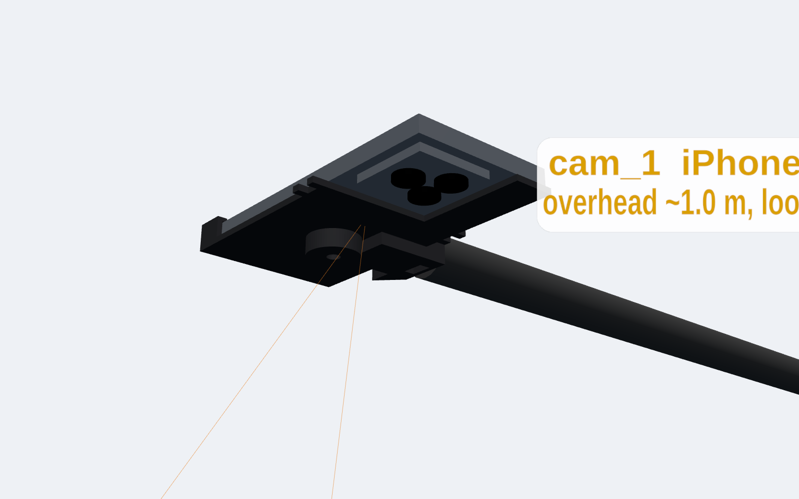

# iPhone camera cradles (rig: 1× iPhone 16 Pro overhead + 2× iPhone 14 Pro Max angled)

These are printable cradles that hold each phone rigidly on a standard 1/4"-20 tripod screw. They exist because **extrinsic calibration is only valid while the phones don't move**. If a phone shifts in its mount after calibration, every 3D position will be wrong without any warning, so the mount is part of the calibration system.

| cam id | phone | placement | print file |
|---|---|---|---|
| `cam_1` | iPhone 16 Pro | overhead, ~1.0 m above table centre, looking straight down, hung from a boom arm by the **edge mount** | `stl/print_plate_1x_iphone_16_pro.stl` |
| `cam_2` | iPhone 14 Pro Max | tripod, 30–45° above the table, 0.6–1.0 m from centre | `stl/print_plate_2x_iphone_14_pro_max.stl` (both on one plate) or `print_plate_1x_…` twice |
| `cam_3` | iPhone 14 Pro Max | tripod, ~110° around the table from `cam_2` | (same plate as `cam_2`) |





## Design
- **Bottom cup:** the phone drops in USB-C end first. A bottom wall and two side walls with 2.4 mm front lips stop it from lifting or sliding sideways. A 16 mm slot lets a charging cable through.
- **Open camera corner:** a 54 × 56 mm window is cut out completely, so the plate never blocks the lenses, flash or LiDAR. The camera bump is roughly 37–40 mm square.
- **Short wall on the button edge:** this keeps the side button and the 16 Pro's Camera Control free.
- **Back 1/4"-20 nut (all cradles):** drop a standard 7/16" hex nut into the hex pocket from the phone side, and the phone then holds it in. The tripod screw goes in from the back. Use this on the side tripods.
- **Edge 1/4"-20 nut (16 Pro only):** a second nut sits on the long edge opposite the camera. Slide the nut into the slot from the back. The boom arm screws in from the side, so nothing hangs in the overhead camera's view. The bolt hole is blind, so a long screw can't reach the phone.
- **Band posts:** put a hair tie between the post pairs just below the camera window. It locks the top of the phone against the plate.

## Parts list
- 4× 1/4"-20 hex nut, 7/16" across flats: one per cradle, plus one for the 16 Pro edge mount. Ask at the hardware checkout desk.
- 2× tripod for `cam_2` and `cam_3`.
- 1× boom arm, C-stand or clamp arm with a 1/4"-20 screw for `cam_1`. A ball head between the arm and the cradle makes aiming straight down easy.
- 3× hair tie or silicone band.

## Printing (Cal Hacks queue: Bambu P1S or Flashforge Adventurer 5M, 3.5 h max per job, one STL per submission)
The STLs in `stl/print_plate_*` are already oriented. Each part **stands upright on its USB-C end**, so no supports are needed: the overhangs are only short bridges and 45° gussets.

| submission | file | P1S-like estimate | slower-printer estimate | filament |
|---|---|---|---|---|
| A | `print_plate_2x_iphone_14_pro_max.stl` (cam_2 + cam_3) | ~2 h 10 m | ~3 h 05 m | ~93 g |
| B | `print_plate_1x_iphone_16_pro.stl` (cam_1) | ~1 h 25 m | ~1 h 45 m | ~45 g |
| alt | `print_plate_1x_iphone_14_pro_max.stl` (one cradle) | ~1 h 20 m | ~1 h 40 m | ~47 g |

These estimates come from PrusaSlicer 2.7 with generic fast-printer settings. Bambu Studio's own estimate is the one that counts. The settings were:
- 0.24 mm layers
- 3 walls
- 15 % gyroid infill
- 5 mm brim, which the tall parts need
- no supports

Things to put in the submission form:
- **Printer:** Bambu P1S. Plate A on the slower setting comes close to the 3.5 h cap (prep time counts toward it). If the 5M is the only printer free, submit one cradle per job instead.
- **Settings field:** "Print as oriented (standing upright), NO supports, 5 mm brim, 0.24 mm layers, 3 walls, 15% infill."
- **Filament:** Black first. A dark mount reflects less light back into the lenses.
- **Splitting jobs:** a person can only have one job in the queue at a time. Split A and B across two teammates so both print at once.

## Build / test
```bash
pip install manifold3d trimesh numpy pytest
python camera/hardware/iphone_cradles/generate_mounts.py              # bare phones
python camera/hardware/iphone_cradles/generate_mounts.py --case 1.5   # phones in ~1.5 mm cases
cd camera/hardware/iphone_cradles && python -m pytest -q              # fit, open camera corner, edge-nut fit + blind hole
```
All the dimensions are in `phone_models.json` and at the top of `generate_mounts.py`.

## Verify before relying on it (not yet measured)
- Measure the camera bump and the button positions on the actual phones with calipers. The notch and wall heights are based on spec sheets plus margins.
- Do a test fit of the first print before printing the rest. If the phone rattles, reduce `CLEARANCE` (0.4 mm per side) or add thin foam.
- Phone cases change every dimension. Use `--case`, or take the cases off (recommended).
