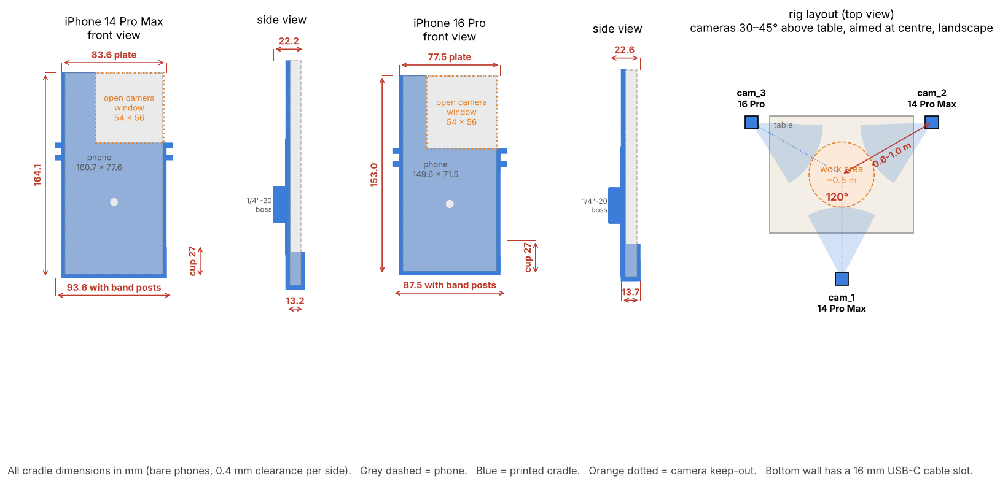
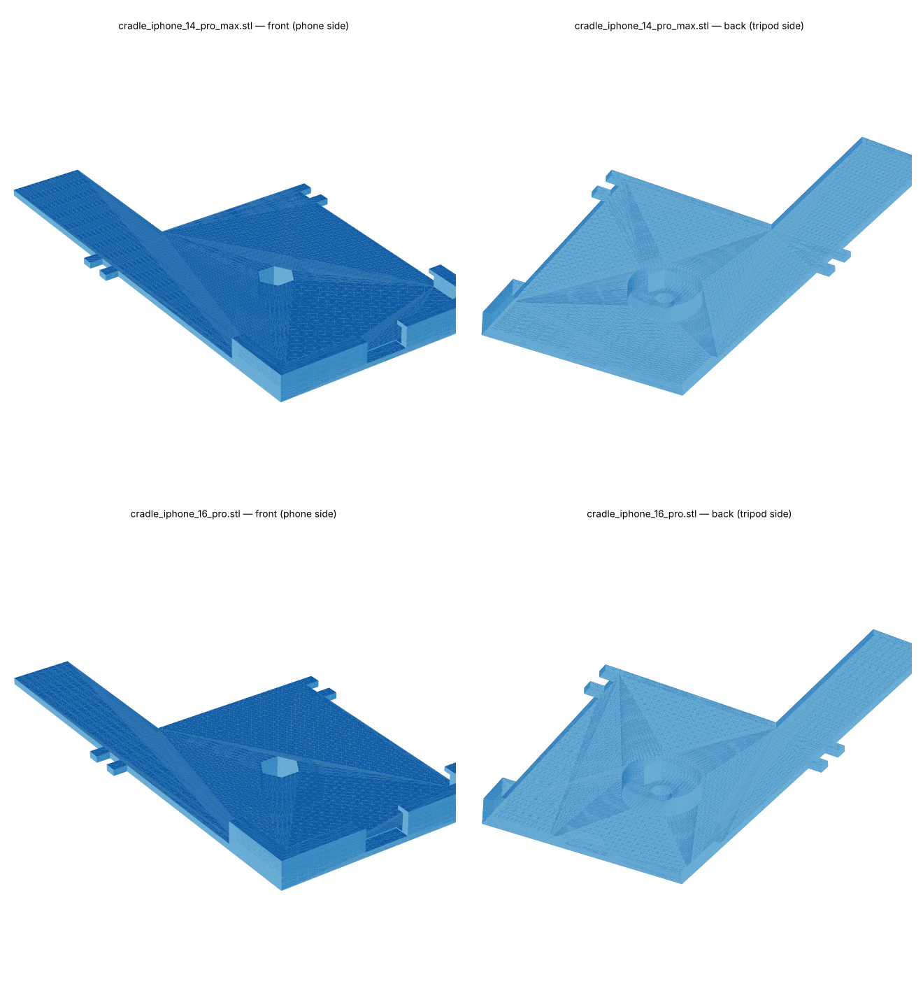

# iPhone camera cradles (rig: 2× iPhone 14 Pro Max + 1× iPhone 16 Pro)

These are printable cradles that hold each phone rigidly on a standard 1/4"-20 tripod, clamp arm or ball head. They exist because **extrinsic calibration is only valid while the phones don't move**. If a phone shifts in its mount after calibration, every 3D position will be wrong without any warning, so the mount is part of the calibration system.

| cam id | phone | STL |
|---|---|---|
| `cam_1` | iPhone 14 Pro Max | `stl/cradle_iphone_14_pro_max.stl` |
| `cam_2` | iPhone 14 Pro Max | `stl/cradle_iphone_14_pro_max.stl` (print twice) |
| `cam_3` | iPhone 16 Pro | `stl/cradle_iphone_16_pro.stl` |





## Design
- **Bottom cup:** the phone drops in USB-C end first. A bottom wall and two side walls with 2.4 mm front lips stop it from lifting or sliding sideways. A 16 mm slot lets a charging cable through.
- **Open camera corner:** a 54 × 56 mm window is cut out completely, so the plate never blocks or vignettes the lenses, flash or LiDAR. The bump is roughly 37–40 mm square.
- **Short wall on the button edge:** this keeps the side button and the 16 Pro's Camera Control free, so nothing presses them while recording.
- **Captive 1/4"-20 nut:** drop a standard 7/16" hex nut into the hex pocket from the phone side, and the phone then holds it in. The tripod screw goes in from the back.
- **Band posts:** put a hair tie or silicone band between the post pairs just below the camera window. It locks the top of the phone against the plate.

## Build
```bash
pip install manifold3d trimesh numpy pytest
python camera/mounts/generate_mounts.py              # bare phones
python camera/mounts/generate_mounts.py --case 1.5   # phones in ~1.5 mm cases
cd camera/mounts && python -m pytest -q              # checks for no collision with the phone body and an unobstructed camera corner
```
All the dimensions are in `phone_models.json` and at the top of `generate_mounts.py`.

**Print settings:** PETG (or PLA), 0.2 mm layers, 4 walls, 30 % infill. Print with the back plate flat on the bed and the boss facing up, no supports.

## Verify before relying on it (not yet measured)
- Measure the camera bump and the button positions on the actual phones with calipers. The notch and wall-height values come from Apple's body specs plus generous margins; they were not measured.
- Do a test fit. If the phone rattles, reduce `CLEARANCE` (0.4 mm per side) or add a strip of thin foam.
- Phone cases change every dimension. Use `--case`, or take the cases off (recommended).
