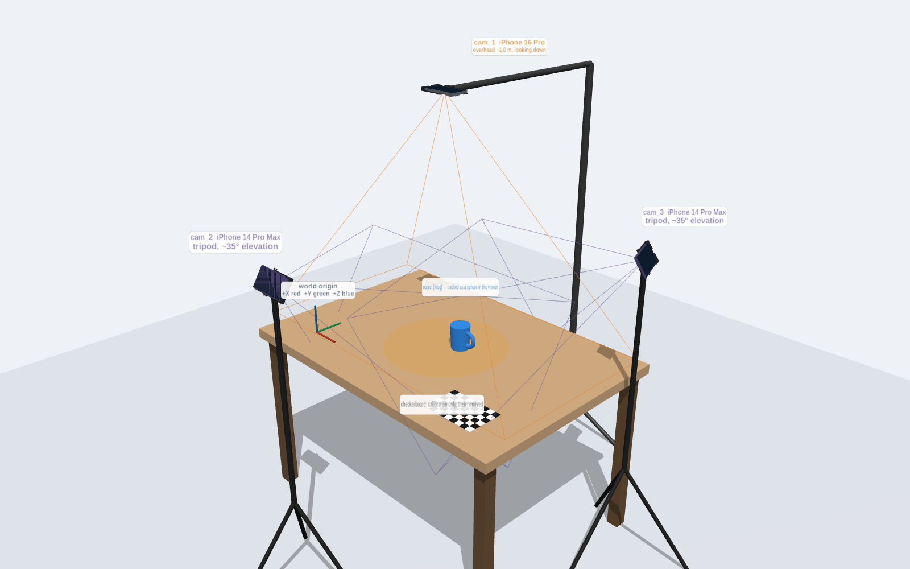

# Camera setup (Agent 1)

## Hardware
| cam id | phone | mount |
|---|---|---|
| `cam_1` | iPhone 16 Pro | overhead: cradle edge mount (1/4"-20) on a boom arm / C-stand |
| `cam_2` | iPhone 14 Pro Max | tripod: cradle back mount (1/4"-20) |
| `cam_3` | iPhone 14 Pro Max | tripod: cradle back mount (1/4"-20) |

The cradles, print files and parts list are in `camera/mounts/`. The machine-readable version of this table is `camera/mounts/phone_models.json` → `rig`.

## Physical layout

**`cam_1` (overhead)**
- Mount it about 1.0 m directly above the centre of the work area, looking straight down.
- From there the 1× camera in 16:9 video sees roughly 1.2 × 0.7 m of table. That figure is estimated from the spec, not measured.
- This camera gives the most accurate left/right and forward/back position.
- The boom approaches from the side, so the arm and stand stay out of the other cameras' views where possible.

**`cam_2` and `cam_3` (angled)**
- Put each on a tripod 0.6–1.0 m from the centre, 30–45° above the tabletop, aimed at the centre.
- Place them about 90–120° apart around the table.
- These two supply height (Z). Each also crosses the overhead view at roughly 45–60°, which is a good angle for triangulation.

**All cameras**
- Landscape orientation, the same for the whole session.
- Every part of the work area must be seen by at least two cameras.
- Hands reaching in from above will block `cam_1`. The angled cameras must still cover the object when that happens.

## Lock the optics before calibrating
- Use the **1× main (wide) camera only**. iPhones switch automatically to macro or ultra-wide at close range, and a switch makes the intrinsics invalid. The sender must select a fixed lens.
- Lock focus and exposure (AE/AF lock), turn off zoom, and turn off video stabilization, since stabilization crops and warps the frame.
- If any of these change, re-run intrinsics for that camera.
- If any phone is bumped or re-seated in its cradle, re-run extrinsics.
- The calibration checkerboard lies flat on the table, where `cam_1` sees it square-on. Remove it after calibration; it must never be attached to a tracked object.

## Camera IDs
`cam_1`..`cam_3` are fixed to the physical phones listed above and must stay the same after a reconnect. Label each phone and cradle physically, for example with tape on the cradle.
